<div align="center">




</div>

> 🍴 Forked from [rolling-scopes-school/tic-tac-toe](https://github.com/rolling-scopes-school/tic-tac-toe), a JavaScript class-design exercise.

## 🎯 What I Practiced

- Designing a `TicTacToe` **class** with clean state management
- Turn handling, **winner and draw detection**
- Writing code against a **Mocha test suite** (test-driven development)

## 🚀 Run It

```bash
git clone https://github.com/Hamnakhan123/tic-tac-toe.git
cd tic-tac-toe
npm install
npm test           # run the test suite
npm start          # open the game in the browser
```

<details>
<summary><b>📜 Original task description</b></summary>

### Tic Tac Toe

---
⚠️ DO NOT SUBMIT PRS WITH SOLUTIONS TO THIS REPO ⚠️

### Description

Your task is to implement `TicTacToe` class

#### Methods:

##### `getCurrentPlayerSymbol()`
should return `x` or `o`

##### `nextTurn(row, col)`
should properly update class state (change current player, update marks storage etc.)

##### `isFinished()`
should return true if game is finished (e.g. there is a winner or it is a draw)

##### `getWinner()`
should return winner symbol (`x` or `o`) or null if there is no winner yet

##### `noMoreTurns()`
should return true if there is no more fields to place a `x` or `o`

##### `isDraw()`
should return true if there is no more turns and no winner

##### `getFieldValue(row, col)`
should return `matrix[row][col]` value (if any) or `null`

### Prerequisites
1. Install [Node.js](https://nodejs.org/en/download/)   
2. Fork this repository: https://github.com/rolling-scopes-school/tick-tac-toe/
3. Clone your newly created repo: https://github.com/<%your_github_username%>/tick-tac-toe/  
4. Go to folder `tick-tac-toe`  
5. To install all dependencies use [`npm install`](https://docs.npmjs.com/cli/install)  
6. Run `npm test` in command line or you can run tests in browser with `npm start` and open http://localhost:8080
7. You will see the number of passing and failing tests. 100% of passing tests is equal to 100p in score  

---

### Submit to [rs app](https://app.rs.school)
1. Open [rs app](https://app.rs.school) and login
2. Open `RS APP` and click `Auto Test`
3. Select your task (tick-tac-toe)
4. Press the submit button and enjoy

---

### Notes
1. We recommend you to use nodejs of version 14 or lower. If you using any of features that does not supported by node v10, score won't be submitted.
2. Please be sure that each of your test in limit of 30sec.

---

© [lesnitsky](https://github.com/lesnitsky)

</details>

---

<div align="center">

**Built by [Hamna Zahid Khan](https://github.com/Hamnakhan123)** · Software Engineer · Lecturer · Web Developer · Event Organizer

[](https://hamnakhan123.github.io/Hamna_Portfolio/)
[](mailto:hamnazahidkhan@gmail.com)
[](https://github.com/Hamnakhan123)

</div>
